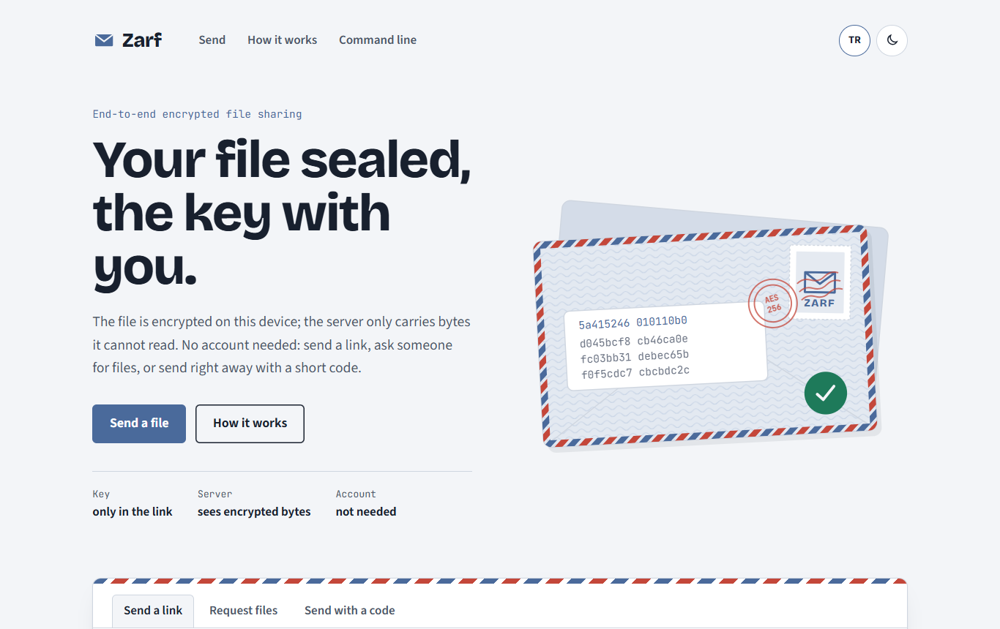
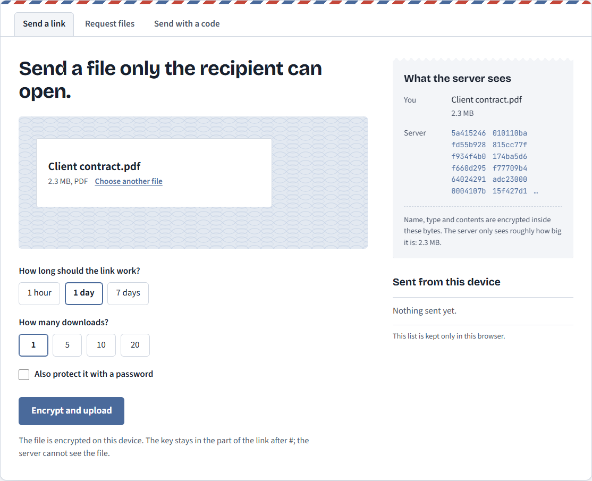
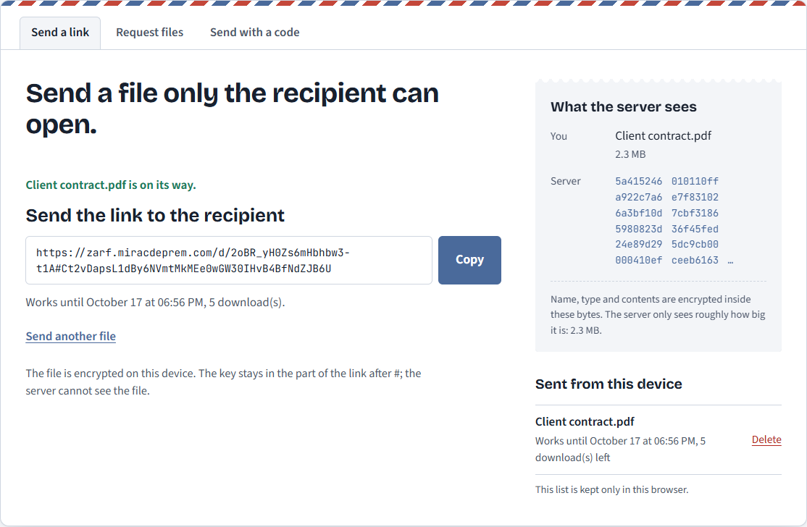
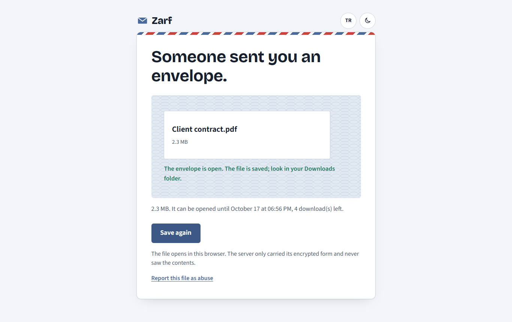
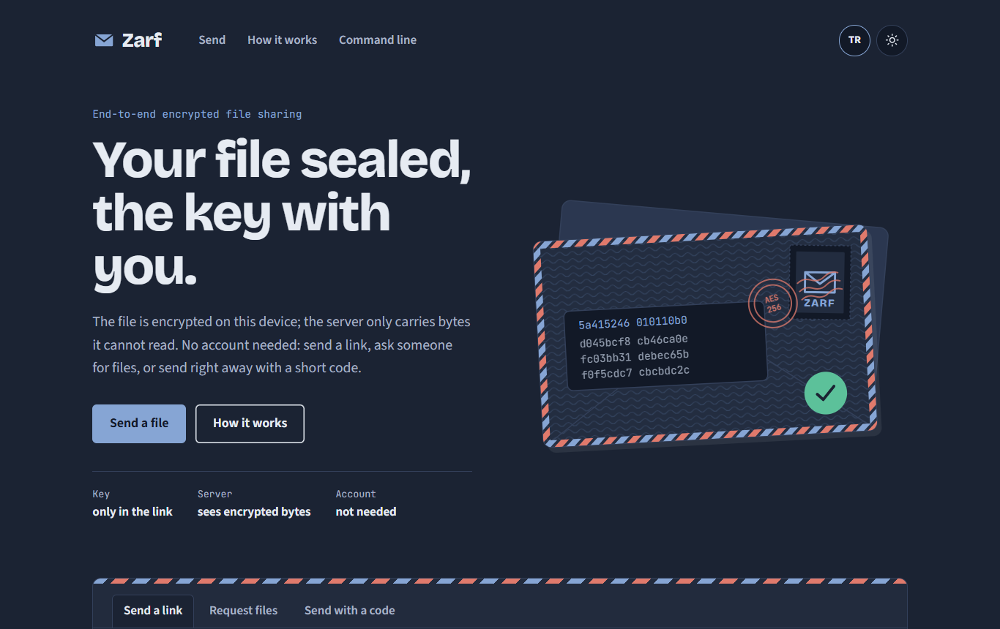
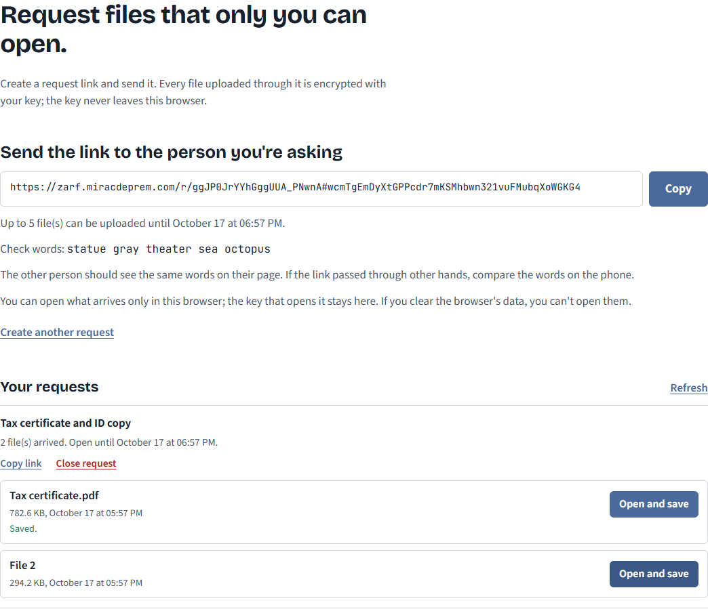
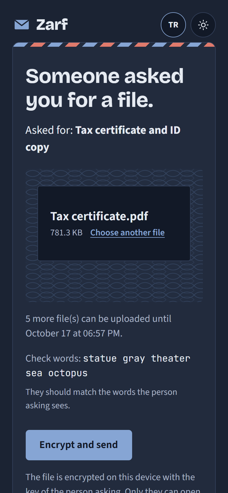
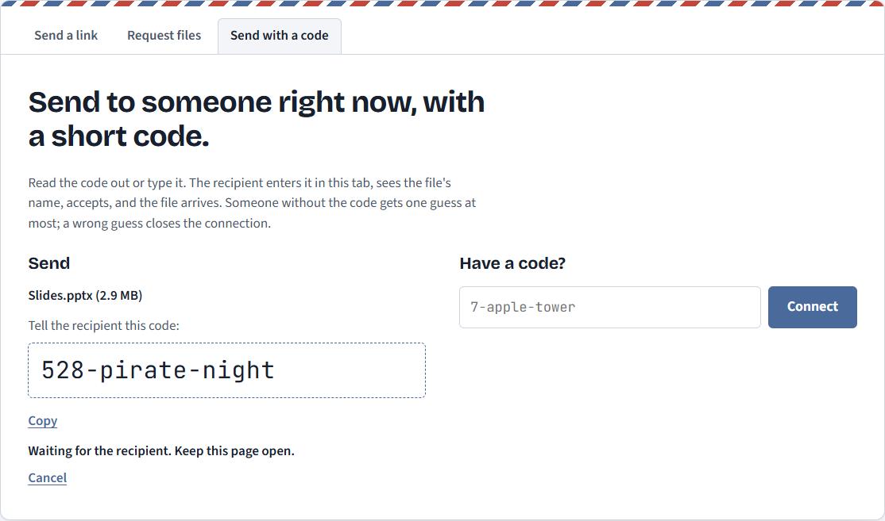
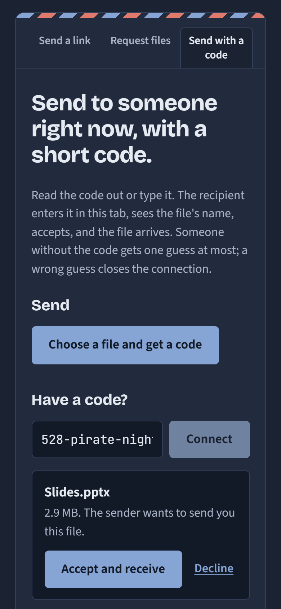
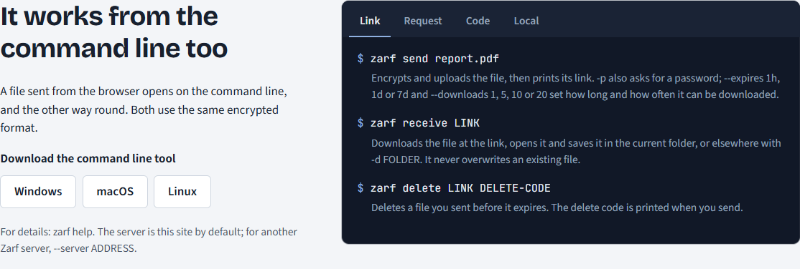

# Zarf

**English** | [Türkçe](README.tr.md)

End-to-end encrypted file sharing, in the browser and from the command line. A file is encrypted on your device before it leaves it, so the server only stores and passes on bytes it cannot read: not the contents, not the name, not the type.

Accountants, lawyers and HR teams send ID copies, contracts and medical reports by e-mail every day, and ordinary file-sharing services can read whatever they store. Zarf is built so that its server cannot: the key never reaches it.

**Live:** [zarf.miracdeprem.com](https://zarf.miracdeprem.com)



## Features

- **Three ways to send:**
  - **Send a link.** The file is encrypted and uploaded; the key goes into the part of the link after `#`, which browsers never send to a server.
    - The link works for 1 hour, 1 day or 7 days, for 1, 5, 10 or 20 downloads.
    - An optional password: a leaked link alone opens nothing.
    - The sender can delete the file early from the list of what they sent.
    - A "What the server sees" panel shows, while you send, the actual first bytes the server receives.
  - **Request files.** You create a request link and send it to someone; whatever they upload through it is encrypted with your key, so only you can open it.
    - A note says what you need; you choose how long the request stays open and how many files may arrive (1 to 20).
    - Arrived files appear in your list, are opened in your browser, and the request can be closed (deleting what arrived).
    - Five check words on both sides let you confirm the key over the phone if the link passed through other hands.
  - **Send with a code.** While both of you are online, the sender gets a short code like `7-apple-tower` and reads it out; the recipient types it in Turkish or English.
    - A password-authenticated key exchange turns the short code into a strong key. Someone without the code gets exactly one guess, and a wrong guess closes the channel for good.
    - The recipient sees the file's name and size and accepts before any content is sent.
    - Browsers connect directly (WebRTC) when they can; otherwise the encrypted bytes go through the server.
- **Receiving:** the file is downloaded, verified chunk by chunk and saved only after the last chunk checked out; a changed or cut file is never saved. A wrong password does not use up a download.
- **Command line:** the `zarf` tool does all three ways of sending, plus encrypting and decrypting files locally without any server. A file sent from the browser opens on the command line and the other way round.
- **Large files:** up to 1024 MB, encrypted in 64 KiB chunks and uploaded in 8 MB parts that resume after a broken connection, so a file never has to fit in memory.
- **Self-hosting:** one Go program serves the API and the web pages.
- **Interface:** Turkish and English, light and dark themes, designed for phones too.

## Screenshots

| Choosing a file: the bytes the server would get | The link, ready to share |
|---|---|
|  |  |

| The receiving page, opened | The dark theme |
|---|---|
|  |  |

| Requests and what arrived | Answering a request on a phone |
|---|---|
|  |  |

| A code to read out | The recipient accepts |
|---|---|
|  |  |

| The command line, one tab per way of sending |
|---|
|  |

## How it keeps files private

- **Own protocol, standard parts.** Zarf invents no cryptography. It combines well-studied building blocks: AES-256-GCM, HKDF-SHA256, X25519, Argon2id and CPace over ristretto255. The protocol and the threat model are written down first ([PROTOCOL.md](docs/PROTOCOL.md), [THREAT-MODEL.md](docs/THREAT-MODEL.md)), and the code follows them.
- **One format everywhere.** Every file travels as an envelope: a header, the encrypted name and size padded to hide their length, and the content in 64 KiB chunks (the STREAM construction), so reordering, cutting or extending the file is detected.
- **Key commitment.** The header carries a commitment to the key, checked before anything is decrypted. A wrong key or password is caught at once, and a file crafted to open under two keys is refused.
- **Two implementations, one set of bytes.** The Go and TypeScript code pass the same test vectors, including the ones that must be rejected (a flipped header byte, a reordered or cut chunk, a wrong key). CPace is checked against the vectors of its IETF draft in both languages.
- **The server knows little.** It stores envelopes, sizes, expiry times and hashes of the tokens it handed out. It never receives a key, never stores network addresses, and limits uploads, requests and live channels per address.
- **Live connections.** The WebRTC setup messages are encrypted with a key from the code exchange, so the server cannot place itself in the direct connection. The server runs its own STUN responder, so no third-party service learns who connects to whom.
- **The web page.** A strict Content Security Policy allows only the site's own scripts, styles and fonts, and Trusted Types stops the page from turning text into HTML. Everything from a sender (a file name, a request note) is written as plain text, and a downloaded file is saved under a cleaned name.
- **Known limit.** Encryption in a web page is only as trustworthy as the code the server delivers; the command line tool does not depend on it. This and the other limits are listed in the threat model.

## Tech Stack

- **Server and command line:** Go, standard library `net/http` and `crypto`, SQLite ([modernc.org/sqlite](https://modernc.org/sqlite), no C compiler needed), [coder/websocket](https://github.com/coder/websocket) for the live relay, [gtank/ristretto255](https://github.com/gtank/ristretto255) for CPace
- **Web:** TypeScript and Vite, no framework; the Web Crypto API, WebRTC, [@noble/hashes](https://github.com/paulmillr/noble-hashes) for Argon2id and [@noble/curves](https://github.com/paulmillr/noble-curves) for ristretto255
- **Tests:** Go tests, Node's test runner, and browser tests run with Playwright
- **Hosting:** Oracle Cloud (Always Free) behind Caddy for HTTPS

## Installation

The quickest way to use Zarf is the [live site](https://zarf.miracdeprem.com).

### The command line tool

**Windows:** download [zarf-setup.exe](https://github.com/MrcDprm/zarf-file-share/releases/latest/download/zarf-setup.exe) and install it (no administrator rights needed). Then open **Zarf** from the Start menu, or type `zarf` in any PowerShell or Command Prompt window. If Windows says it protected your PC, choose More info, then Run anyway: the installer is not signed.

**macOS and Linux:** open a terminal and run

```bash
curl -fsSL https://zarf.miracdeprem.com/install.sh | sh
```

The script picks the right build, checks its SHA-256 and installs `zarf` in `~/.local/bin`, without administrator rights. Then type `zarf` in any terminal.

With Go: `go install github.com/MrcDprm/zarf-file-share/cmd/zarf@latest`. Plain archives for every system are on the [release page](https://github.com/MrcDprm/zarf-file-share/releases/latest).

`zarf` on its own shows the most used commands, in English and Turkish:

```bash
zarf send report.pdf                          # prints a link
zarf receive "https://zarf.miracdeprem.com/d/...#..."
zarf request new --note "tax certificate"     # prints a request link
zarf request get ID                           # opens what arrived
zarf send --code slides.pptx                  # prints a code like 7-apple-tower
zarf receive 7-apple-tower
zarf help                                     # every command
```

The tool talks to `https://zarf.miracdeprem.com` unless `--server` or `ZARF_SERVER` says otherwise.

### Running your own server

You need Go 1.27 and Node.js 24.

```bash
git clone https://github.com/MrcDprm/zarf-file-share.git
cd zarf-file-share
cd web && npm ci && npm run build && cd ..   # the web pages, built into the server
go build -o zarf-server ./cmd/zarf-server
./zarf-server -addr 127.0.0.1:8080 -data /var/lib/zarf
```

Put an HTTPS proxy such as Caddy in front of it and start the server with `-trust-proxy`, so the limits per address see the visitor's address; [deploy/](deploy) has the Caddyfile and a hardened systemd service used for the live site. `-quota` sets how much space all stored files may take (in GB, default 100). Open UDP port 3478 for the STUN responder of direct live connections, or turn it off with `-stun off`. Without the built web pages the server still runs, offering only the API for the command line.

For development, run the server as above and `npm run dev` in `web/`; Vite passes `/api` (WebSockets included) to the server.

### Tests

```bash
go test ./...
cd web && npm test
```

### Project structure

```
cmd/zarf/             The command line tool: send, receive, request, encrypt, decrypt
cmd/zarf-server/      The server program: serve, list abuse reports, remove a file
internal/envelope/    The envelope format: header, keys, metadata, chunked encryption
internal/cpace/       CPace, the key exchange of live mode
internal/live/        Live mode on the command line
internal/server/      HTTP API, storage, request uploads, the live relay, STUN, the web pages
internal/words/       The word lists of codes and check words
internal/safename/    Turning a sender's file name into a safe local name
web/src/lib/          The same protocol in TypeScript, plus the API client
web/src/              The pages: sending, receiving, requests, live mode
web/test/             TypeScript tests, including the shared test vectors
docs/                 The protocol and the threat model
testdata/vectors/     Test vectors both implementations must pass
```

## What I Learned

- **Writing the protocol before the code.** I described every byte of the envelope in PROTOCOL.md first, then wrote it in Go, then in TypeScript. Shared test vectors kept the two from drifting apart, and the first time a file encrypted in the browser opened on the command line, it was because both followed the same document, not because I had tested them against each other.
- **Where a key can hide from a server.** The part of a link after `#` never leaves the browser, so it can carry the key. The page reads it, then removes it from the address bar so it does not stay in history or screenshots.
- **Why "the decryption failed" is not enough.** AES-GCM alone can be made to decrypt one ciphertext under two different keys, which would let a server test password guesses. A key commitment in the header rules that out, and it also let me check a password before downloading anything else, so a typo never costs a download.
- **Streaming without trusting the end.** A file is encrypted in chunks, and the last chunk is marked as last inside its nonce. A cut stream is caught, and nothing is saved before the last chunk verified.
- **Short codes that are still safe.** A code like `7-apple-tower` holds only 16 bits, which would be guessed in seconds offline. CPace makes guessing possible only online, one try per channel, and the channel closes after a wrong one. I implemented CPace in both TypeScript and Go and checked both against the draft's own test vectors.
- **Direct connections without a third party.** For two browsers to connect directly they need to learn their public addresses, usually from Google's STUN servers. The protocol for that is small, so the Zarf server answers it itself in about a hundred lines of Go.
- **Keys a script cannot read.** In request mode the private key is a non-extractable Web Crypto key in IndexedDB: the page can use it to open files, but no script, not even the page's own, can read its bytes.
- **Bugs the tests found.** On the Windows console, passwords with "ş" or "ğ" produced the wrong key because the console read them in an old code page; reading them as Unicode (`ReadConsoleW`) fixed it. Closing a live channel lost the reason ("the other side left", "too large"), because cancelling the read cut the connection before the close message went out. Opening a corrected link in the same tab did nothing, because a change after `#` is not a new page to the browser.
- **Testing a page that blocks the test tool.** The strict Content Security Policy also refused the test tool's own injected code; the tests now wait from outside the page, which showed the policy really works.

## Credits

- Fonts: [Source Sans 3](https://github.com/adobe-fonts/source-sans) and [JetBrains Mono](https://github.com/JetBrains/JetBrainsMono) (SIL Open Font License), served from the site itself
- [@noble/hashes](https://github.com/paulmillr/noble-hashes) and [@noble/curves](https://github.com/paulmillr/noble-curves) (MIT), [coder/websocket](https://github.com/coder/websocket) (ISC), [gtank/ristretto255](https://github.com/gtank/ristretto255) (BSD-3-Clause), [modernc.org/sqlite](https://gitlab.com/cznic/sqlite) (BSD-3-Clause)

## License

[MIT](LICENSE)
