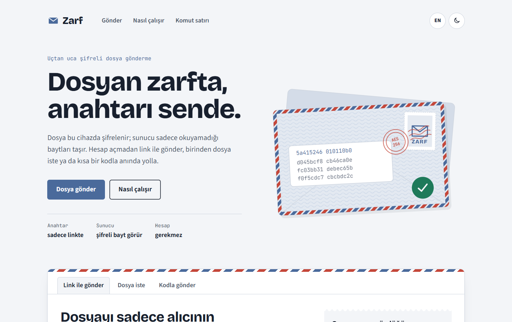
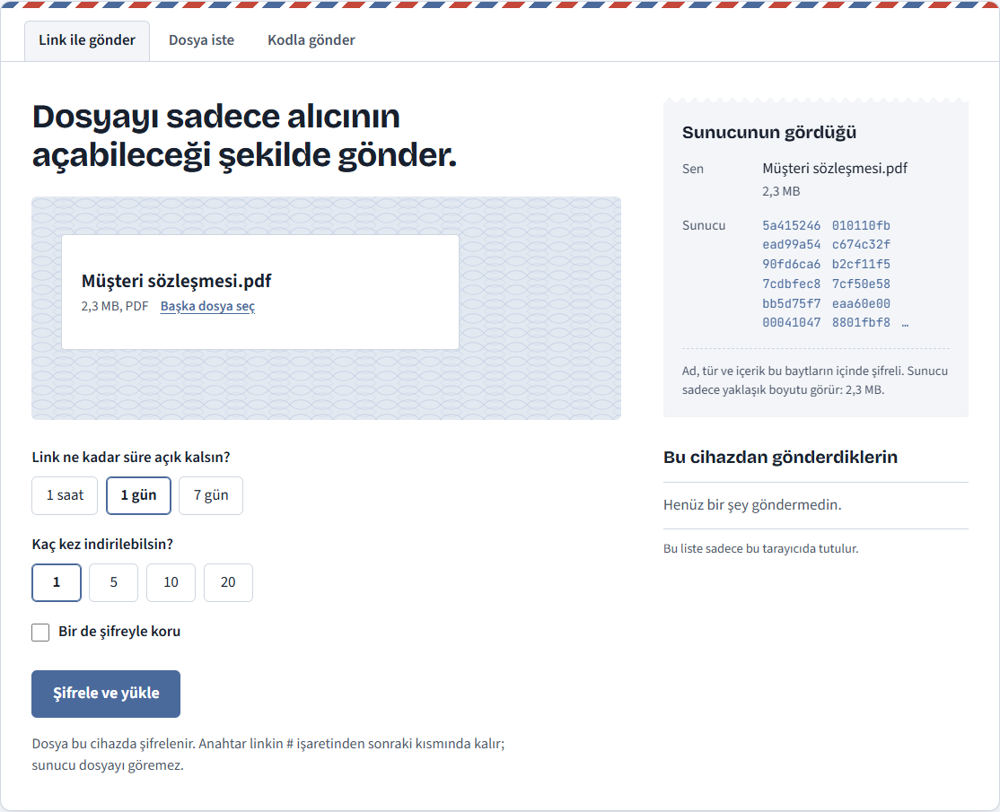
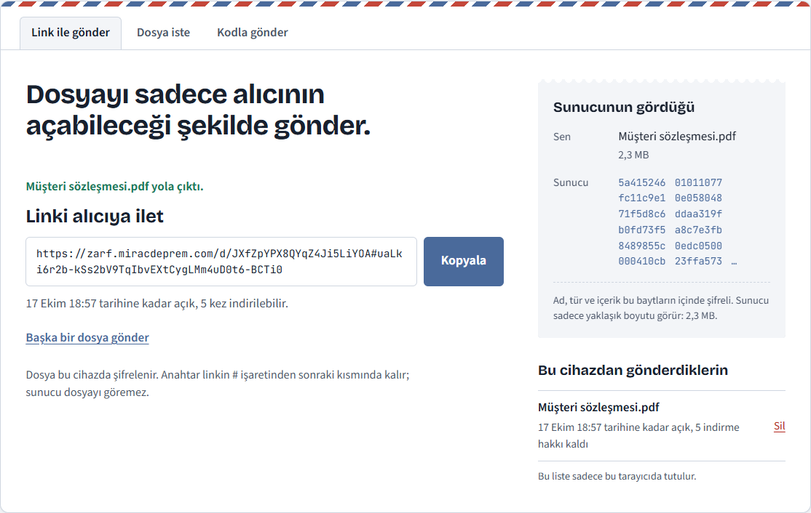
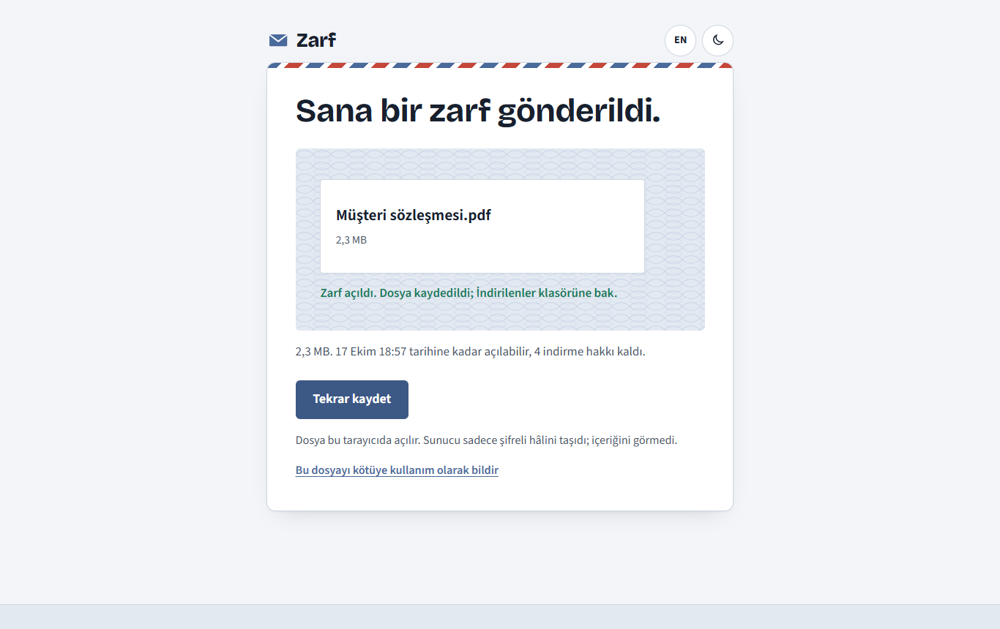
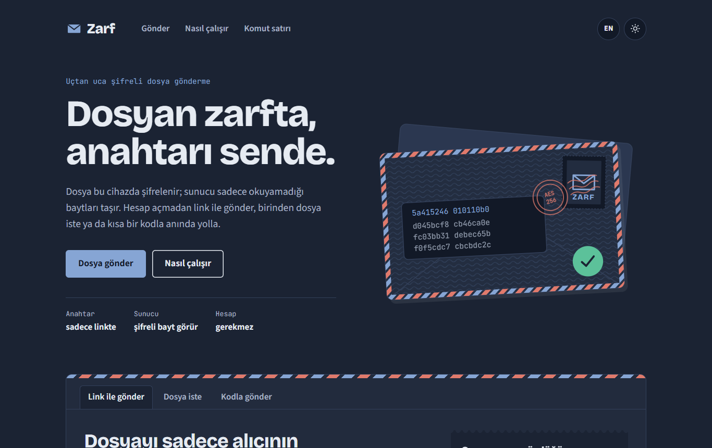
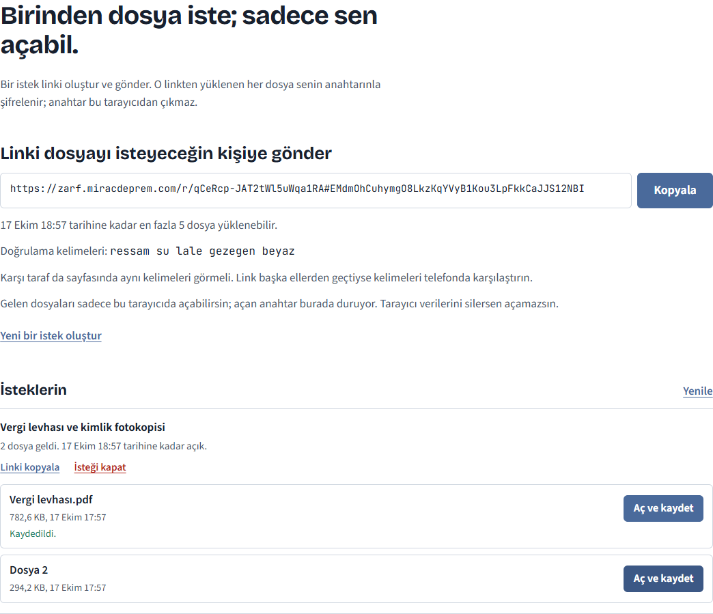
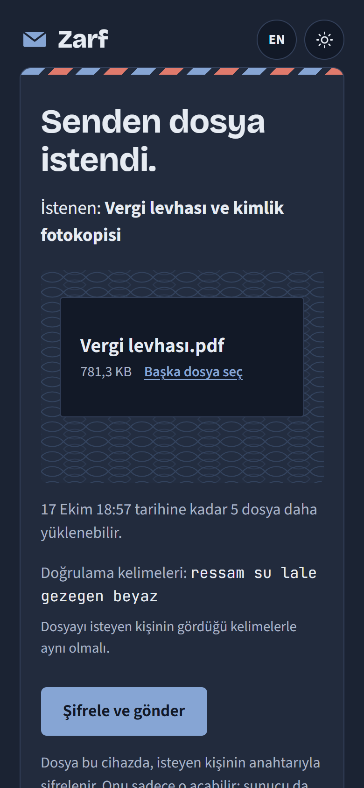
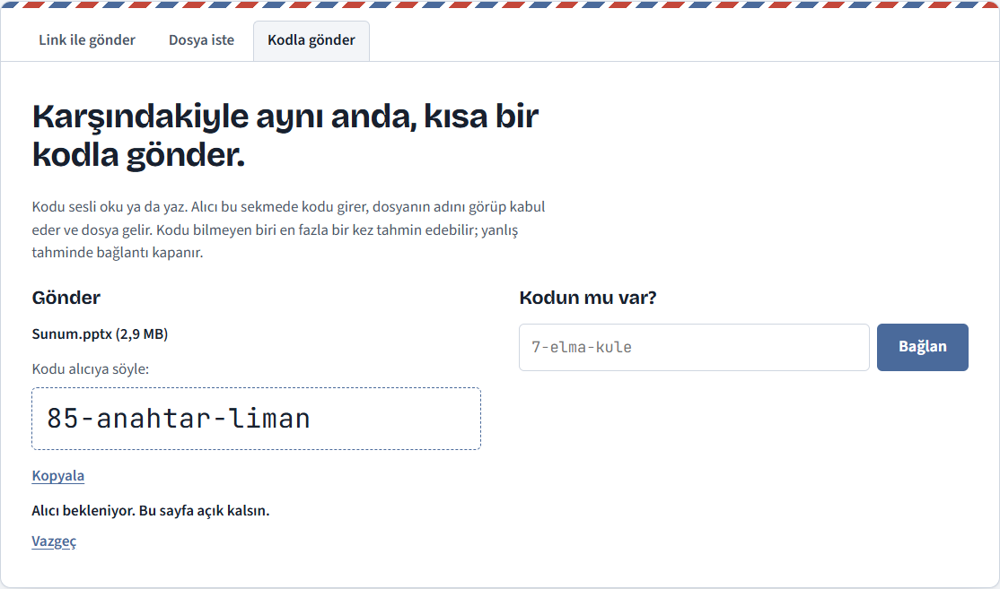
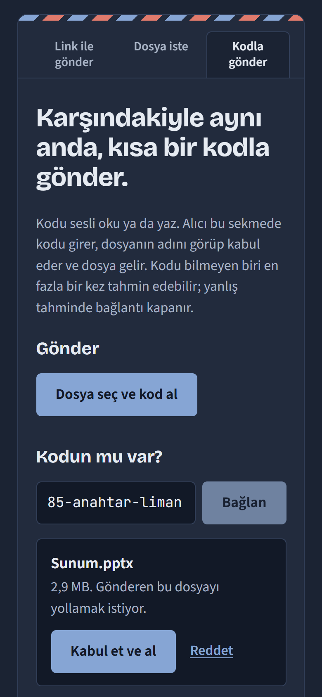
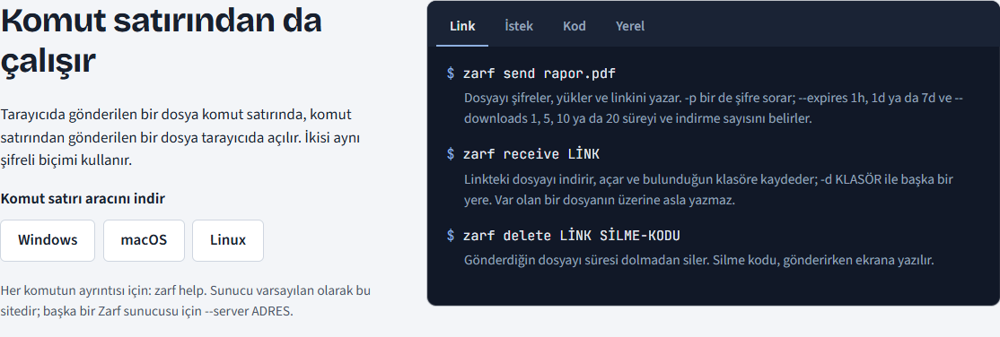

# Zarf

[English](README.md) | **Türkçe**

Tarayıcıda ve komut satırında çalışan, uçtan uca şifreli dosya paylaşımı. Dosya cihazından çıkmadan önce şifrelenir; sunucu sadece okuyamadığı baytları saklar ve iletir. İçeriği, adı ve türü sunucuya hiç açık gitmez.

Muhasebeciler, avukatlar ve İK ekipleri her gün kimlik fotokopisi, sözleşme ve sağlık raporu gibi belgeleri e-postayla gönderiyor; sıradan dosya paylaşım servisleri de sakladıklarını okuyabiliyor. Zarf, sunucusu okuyamasın diye tasarlandı: anahtar sunucuya hiç ulaşmaz.

**Canlı:** [zarf.miracdeprem.com](https://zarf.miracdeprem.com)



## Özellikler

- **Üç gönderme yolu:**
  - **Link ile gönder.** Dosya şifrelenip yüklenir; anahtar linkin `#` işaretinden sonraki kısmına konur ve tarayıcılar o kısmı hiçbir sunucuya göndermez.
    - Link 1 saat, 1 gün ya da 7 gün; 1, 5, 10 ya da 20 indirme için çalışır.
    - İsteğe bağlı şifre: sızan bir link tek başına hiçbir şey açmaz.
    - Gönderen, gönderdikleri listesinden dosyayı süresi dolmadan silebilir.
    - "Sunucunun gördüğü" paneli, gönderirken sunucuya giden gerçek ilk baytları gösterir.
  - **Dosya iste.** Bir istek linki oluşturup birine gönderirsin; o linkten yüklenen her şey senin anahtarınla şifrelenir, sadece sen açabilirsin.
    - Bir notla ne istediğini yazarsın; isteğin ne kadar açık kalacağını ve en fazla kaç dosya geleceğini (1-20) seçersin.
    - Gelen dosyalar listende görünür ve tarayıcında açılır; istek kapatılınca gelenler de silinir.
    - İki tarafta görünen beş doğrulama kelimesi, link başka ellerden geçtiyse anahtarı telefonda karşılaştırmayı sağlar.
  - **Kodla gönder.** İkiniz de çevrimiçiyken gönderen `7-elma-kule` gibi kısa bir kod alır ve sesli okur; alıcı kodu Türkçe ya da İngilizce yazabilir.
    - Parolayla kimlik doğrulamalı bir anahtar değişimi kısa kodu güçlü bir anahtara çevirir. Kodu bilmeyen biri tam bir kez tahmin edebilir; yanlış tahminde kanal kalıcı olarak kapanır.
    - Alıcı, içerik gönderilmeden önce dosyanın adını ve boyutunu görüp kabul eder.
    - Tarayıcılar mümkünse doğrudan bağlanır (WebRTC); olmazsa şifreli baytlar sunucu üzerinden gider.
- **Alma:** Dosya indirilir, parça parça doğrulanır ve ancak son parça da doğrulandıktan sonra kaydedilir; değiştirilmiş ya da yarım kalmış bir dosya hiç kaydedilmez. Yanlış şifre indirme hakkı harcamaz.
- **Komut satırı:** `zarf` aracı üç gönderme yolunun hepsini yapar; ayrıca hiçbir sunucu olmadan dosyaları yerelde şifreleyip açar. Tarayıcıdan gönderilen dosya komut satırında, komut satırından gönderilen tarayıcıda açılır.
- **Büyük dosyalar:** 1024 MB'a kadar; 64 KiB'lık parçalar hâlinde şifrelenir, bağlantı kopunca kaldığı yerden devam eden 8 MB'lık parçalarla yüklenir. Dosyanın belleğe sığması gerekmez.
- **Kendi sunucunu kurma:** Tek bir Go programı hem API'yi hem web sayfalarını sunar.
- **Arayüz:** Türkçe ve İngilizce, açık ve koyu tema, telefona da uygun tasarım.

## Ekran Görüntüleri

| Dosya seçmek: sunucuya gidecek baytlar | Paylaşmaya hazır link |
|---|---|
|  |  |

| Açılmış alma sayfası | Koyu tema |
|---|---|
|  |  |

| İstekler ve gelenler | Telefonda bir isteğe dosya yükleme |
|---|---|
|  |  |

| Sesli okunacak kod | Alıcı kabul ediyor |
|---|---|
|  |  |

| Komut satırı, her gönderme yolu için bir sekme |
|---|
|  |

## Dosyaları nasıl gizli tutar

- **Kendi protokolü, standart parçalar.** Zarf hiçbir şifreleme yöntemi icat etmez; iyi incelenmiş yapı taşlarını birleştirir: AES-256-GCM, HKDF-SHA256, X25519, Argon2id ve ristretto255 üzerinde CPace. Protokol ve tehdit modeli önce yazıldı ([PROTOCOL.md](docs/PROTOCOL.md), [THREAT-MODEL.md](docs/THREAT-MODEL.md)), kod onları izler.
- **Her yerde tek biçim.** Her dosya bir zarf olarak gider: bir başlık, uzunluğu gizlensin diye dolgulanmış şifreli ad ve boyut, ve 64 KiB'lık parçalar hâlinde içerik (STREAM yapısı). Parçaların yerini değiştirmek, dosyayı kesmek ya da uzatmak fark edilir.
- **Anahtar taahhüdü.** Başlıkta anahtara bağlı bir taahhüt bulunur ve hiçbir şey çözülmeden önce kontrol edilir. Yanlış anahtar ya da şifre hemen yakalanır; iki farklı anahtarla açılacak şekilde hazırlanmış bir dosya reddedilir.
- **İki uygulama, aynı baytlar.** Go ve TypeScript kodu aynı test vektörlerinden geçer; reddedilmesi gerekenler de buna dahil (değişmiş bir başlık baytı, yeri değişmiş ya da kesilmiş bir parça, yanlış anahtar). CPace iki dilde de IETF taslağının kendi vektörleriyle doğrulanır.
- **Sunucu az şey bilir.** Zarfları, boyutları, süreleri ve verdiği belirteçlerin özetlerini saklar. Hiçbir anahtar almaz, ağ adreslerini saklamaz; yüklemeleri, istekleri ve canlı kanalları adres başına sınırlar.
- **Canlı bağlantılar.** WebRTC kurulum mesajları, kod değişiminden türeyen bir anahtarla şifrelenir; sunucu doğrudan bağlantının arasına giremez. Sunucu kendi STUN yanıtlayıcısını çalıştırır, böylece kimin kime bağlandığını hiçbir dış servis öğrenmez.
- **Web sayfası.** Sıkı bir İçerik Güvenliği Politikası (CSP) sadece sitenin kendi script, stil ve fontlarına izin verir; Trusted Types sayfanın metni HTML'e çevirmesini engeller. Gönderenden gelen her şey (dosya adı, istek notu) düz metin olarak yazılır, indirilen dosya temizlenmiş bir adla kaydedilir.
- **Bilinen sınır.** Web sayfasındaki şifreleme, sunucunun gönderdiği kod kadar güvenilirdir; komut satırı aracı buna bağlı değildir. Bu ve diğer sınırlar tehdit modelinde yazılı.

## Kullanılan Teknolojiler

- **Sunucu ve komut satırı:** Go, standart kütüphanedeki `net/http` ve `crypto`, SQLite ([modernc.org/sqlite](https://modernc.org/sqlite), C derleyicisi gerekmez), canlı aktarıcı için [coder/websocket](https://github.com/coder/websocket), CPace için [gtank/ristretto255](https://github.com/gtank/ristretto255)
- **Web:** TypeScript ve Vite, çatı (framework) yok; Web Crypto API, WebRTC, Argon2id için [@noble/hashes](https://github.com/paulmillr/noble-hashes), ristretto255 için [@noble/curves](https://github.com/paulmillr/noble-curves)
- **Testler:** Go testleri, Node'un test aracı ve Playwright ile çalışan tarayıcı testleri
- **Yayın:** Oracle Cloud (Always Free), HTTPS için önünde Caddy

## Kurulum ve Çalıştırma

Zarf'ı kullanmanın en hızlı yolu [canlı site](https://zarf.miracdeprem.com).

### Komut satırı aracı

**Windows:** [zarf-setup.exe](https://github.com/MrcDprm/zarf-file-share/releases/latest/download/zarf-setup.exe) dosyasını indir ve kur (yönetici izni gerekmez). Sonra Başlat menüsünden **Zarf**'ı aç ya da herhangi bir PowerShell veya Komut İstemi penceresinde `zarf` yaz. Windows "bilgisayarınız korundu" derse Ek bilgi, sonra Yine de çalıştır de: kurulum dosyası imzasız.

**macOS ve Linux:** bir terminal açıp şunu çalıştır:

```bash
curl -fsSL https://zarf.miracdeprem.com/install.sh | sh
```

Betik doğru sürümü seçer, SHA-256'sını doğrular ve `zarf`'ı yönetici izni olmadan `~/.local/bin` klasörüne kurar. Sonra her terminalde `zarf` yazman yeter.

Go ile: `go install github.com/MrcDprm/zarf-file-share/cmd/zarf@latest`. Her sistem için düz arşivler [sürüm sayfasında](https://github.com/MrcDprm/zarf-file-share/releases/latest).

Tek başına `zarf`, en çok kullanılan komutları Türkçe ve İngilizce gösterir:

```bash
zarf send rapor.pdf                           # bir link yazar
zarf receive "https://zarf.miracdeprem.com/d/...#..."
zarf request new --note "vergi levhası"       # bir istek linki yazar
zarf request get KİMLİK                       # gelenleri açar
zarf send --code sunum.pptx                   # 7-elma-kule gibi bir kod yazar
zarf receive 7-elma-kule
zarf help                                     # bütün komutlar
```

Araç, `--server` ya da `ZARF_SERVER` başka bir adres söylemedikçe `https://zarf.miracdeprem.com` ile konuşur.

### Kendi sunucunu çalıştırma

Go 1.27 ve Node.js 24 gerekir.

```bash
git clone https://github.com/MrcDprm/zarf-file-share.git
cd zarf-file-share
cd web && npm ci && npm run build && cd ..   # web sayfaları, sunucunun içine gömülür
go build -o zarf-server ./cmd/zarf-server
./zarf-server -addr 127.0.0.1:8080 -data /var/lib/zarf
```

Önüne Caddy gibi bir HTTPS vekili koy ve sunucuyu `-trust-proxy` ile başlat; adres başına sınırlar ziyaretçinin gerçek adresini görsün. Canlı sitede kullanılan Caddyfile ve güvenlik ayarları sıkılaştırılmış systemd servisi [deploy/](deploy) klasöründe. `-quota`, saklanan bütün dosyaların toplam kaç GB yer kaplayabileceğini belirler (varsayılan 100). Canlı moddaki doğrudan bağlantıların STUN yanıtlayıcısı için UDP 3478 portunu aç, ya da `-stun off` ile kapat. Web sayfaları derlenmemişse sunucu yine çalışır, sadece komut satırı için API'yi sunar.

Geliştirirken sunucuyu yukarıdaki gibi çalıştır, `web/` içinde `npm run dev` de; Vite `/api` isteklerini (WebSocket dahil) sunucuya iletir.

### Testler

```bash
go test ./...
cd web && npm test
```

### Proje yapısı

```
cmd/zarf/             Komut satırı aracı: send, receive, request, encrypt, decrypt
cmd/zarf-server/      Sunucu programı: çalıştırma, kötüye kullanım bildirimleri, dosya kaldırma
internal/envelope/    Zarf biçimi: başlık, anahtarlar, meta veri, parça parça şifreleme
internal/cpace/       CPace, canlı modun anahtar değişimi
internal/live/        Komut satırında canlı mod
internal/server/      HTTP API, depolama, isteklere yükleme, canlı aktarıcı, STUN, web sayfaları
internal/words/       Kod ve doğrulama kelimelerinin listeleri
internal/safename/    Gönderenin verdiği dosya adını güvenli bir yerel ada çevirme
web/src/lib/          Aynı protokol TypeScript'te, ve API istemcisi
web/src/              Sayfalar: gönderme, alma, istekler, canlı mod
web/test/             TypeScript testleri, ortak test vektörleri dahil
docs/                 Protokol ve tehdit modeli
testdata/vectors/     İki uygulamanın da geçmesi gereken test vektörleri
```

## Öğrendiklerim

- **Kodu yazmadan önce protokolü yazmak.** Zarfın her baytını önce PROTOCOL.md'de anlattım, sonra Go'da, sonra TypeScript'te yazdım. Ortak test vektörleri ikisinin ayrışmasını engelledi; tarayıcıda şifrelenen bir dosya komut satırında ilk denemede açıldığında bunun sebebi ikisini birbirine karşı test etmem değil, aynı belgeyi izlemeleriydi.
- **Anahtarın sunucudan saklanabileceği yer.** Linkin `#` sonrasındaki kısmı tarayıcıdan hiç çıkmaz, bu yüzden anahtarı taşıyabilir. Sayfa onu okur, sonra geçmişte ya da ekran görüntülerinde kalmasın diye adres çubuğundan siler.
- **"Çözülemedi" neden yetmez.** Tek başına AES-GCM, bir şifreli metnin iki farklı anahtarla çözülmesine izin verecek şekilde kandırılabilir; bu da bir sunucunun şifre tahminlerini denemesini sağlar. Başlıktaki anahtar taahhüdü bunu engelliyor. Aynı taahhüt sayesinde şifreyi dosyanın gerisini indirmeden kontrol edebildim, böylece yazım hatası indirme hakkını harcamıyor.
- **Sonuna güvenmeden akış hâlinde şifreleme.** Dosya parçalar hâlinde şifreleniyor ve son parça, nonce'unun içinde "son" diye işaretleniyor. Kesilmiş bir akış yakalanıyor ve son parça doğrulanmadan hiçbir şey kaydedilmiyor.
- **Kısa ama güvenli kodlar.** `7-elma-kule` gibi bir kod sadece 16 bit taşıyor; çevrimdışı saniyeler içinde tahmin edilirdi. CPace tahmini sadece çevrimiçi ve kanal başına tek denemeye indiriyor, yanlış denemede kanal kapanıyor. CPace'i hem TypeScript'te hem Go'da yazdım ve ikisini de taslağın kendi test vektörleriyle doğruladım.
- **Üçüncü taraf olmadan doğrudan bağlantı.** İki tarayıcının doğrudan bağlanması için dış adreslerini öğrenmeleri gerekiyor; bu genelde Google'ın STUN sunucularından soruluyor. Bunun protokolü küçük olduğu için Zarf sunucusu onu yaklaşık yüz satır Go ile kendisi yanıtlıyor.
- **Hiçbir scriptin okuyamadığı anahtarlar.** İstek modunda gizli anahtar, IndexedDB'de dışa aktarılamaz bir Web Crypto anahtarı. Sayfa onunla dosya açabiliyor ama hiçbir script, sayfanın kendisi bile, baytlarını okuyamıyor.
- **Testlerin bulduğu hatalar.** Windows konsolunda "ş" ya da "ğ" içeren şifreler yanlış anahtar üretiyordu, çünkü konsol onları eski bir kod sayfasıyla okuyordu; Unicode okumak (`ReadConsoleW`) düzeltti. Canlı kanal kapanırken sebep ("karşı taraf ayrıldı", "çok büyük") kayboluyordu, çünkü okumayı iptal etmek bağlantıyı kapanış mesajı gitmeden kesiyordu. Düzeltilmiş bir linki aynı sekmede açmak hiçbir şey yapmıyordu, çünkü `#` sonrasındaki değişiklik tarayıcı için yeni bir sayfa değil.
- **Test aracını engelleyen bir sayfayı test etmek.** Sıkı CSP, test aracının sayfaya enjekte ettiği kodu da reddetti; testler artık sayfanın dışından bekliyor. Bu da politikanın gerçekten çalıştığını gösterdi.

## Teşekkürler

- Fontlar: [Source Sans 3](https://github.com/adobe-fonts/source-sans) ve [JetBrains Mono](https://github.com/JetBrains/JetBrainsMono) (SIL Open Font License), sitenin kendisinden sunulur
- [@noble/hashes](https://github.com/paulmillr/noble-hashes) ve [@noble/curves](https://github.com/paulmillr/noble-curves) (MIT), [coder/websocket](https://github.com/coder/websocket) (ISC), [gtank/ristretto255](https://github.com/gtank/ristretto255) (BSD-3-Clause), [modernc.org/sqlite](https://gitlab.com/cznic/sqlite) (BSD-3-Clause)

## Lisans

[MIT](LICENSE)
